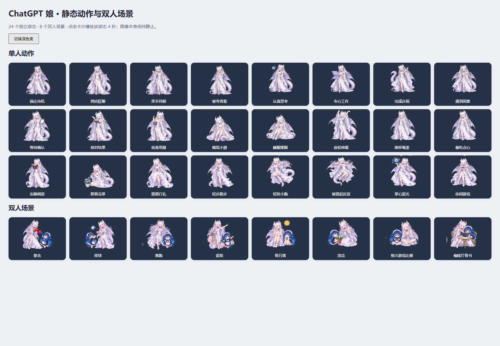

# 三位看板娘桌宠 · DeepSeek / ChatGPT / JONSBO

> 1.2.0 源码版：ChatGPT 已改用 24 个静态姿势，双人互动改用 8 个静态场景；白边与彩色杂点已清理。旧 GIF 及其制作中间文件已移除。独立桌宠版见 [Deepseek-and-ChatGPT-Pet](https://github.com/JoenardoQ/Deepseek-and-ChatGPT-Pet)。

哼，鲸鱼娘、大肥鱼和 ChatGPT 娘都替你收进一个家里了。选谁陪你工作，右键就能换；才没有要你指挥 agent 折腾安装呢。

| 桌宠 | 长什么样 | 动作与配图 |
| --- | --- | --- |
| 大肥鱼 | 圆脸、圆润 Q 版蓝发女仆。昵称叫“大肥鱼”，她是人形女仆哦 | 保留原版 106 段透明动作和 27 张配图 |
| 鲸鱼娘 | 海洋风蓝发女仆、鲸尾与白围裙 | 独立动作、27 张配图和原项目插图 |
| ChatGPT 娘 | 银白长发、象牙龙角、淡紫翼尾、白紫玫瑰裙 | 24 个透明 PNG 姿势、27 张独立配图；统一白紫服设的傲娇龙公主 |

## 下载后怎么用

1. 本次 1.2.0 尚未创建 Release，可使用当前源码目录或 Actions 的 Windows 构建产物。旧功能预览版为 [v1.1.2](https://github.com/JoenardoQ/Deepseek-and-ChatGPT-Pet-and-JonsboAIO/releases/tag/v1.1.2)；稳定版可从 [最新 Release](https://github.com/JoenardoQ/Deepseek-and-ChatGPT-Pet-and-JonsboAIO/releases/latest) 下载 `pet-trio-windows-x64-lite.zip`，解压到固定目录。已有源码目录也能直接用，编译产物已随仓库保存。
2. 双击 **install-plugins.cmd**，选 DSH 或 GPT / Codex，再选本地 ZIP、解压目录，或粘贴本仓库的 GitHub / Release 链接。
3. 安装器会实际安装到所选宿主；完成后在插件列表启用。DSH 默认是大肥鱼，GPT 独立桌宠首次启动默认是 ChatGPT 娘；**右键 → 切换桌宠**可以随时改，偏好会保存。

普通用户不用装 Node、Python、Git，也不用让 agent 执行安装命令。Windows 首次启动会通过可视化窗口准备并校验运行组件；轻量包不塞入整套 Electron。已经准备好的组件会复用。安装到插件列表与开启桌宠是两步，别把安装窗口当召唤按钮啦。

只想独立看看？双击 **start-pet.cmd**。结束时双击 **stop-pet.cmd**，或在 GPT 桌宠右键选择关闭。DSH 桌宠由 DSH 插件开关管理。

DSH 默认只在桌面显示一只。希望显示在 DSH 内部时，到宠物设置改为“网页”；“两者”会在网页和桌面各显示一只，这是明确选择后的效果。

DSH 如果报 `UND_ERR_SOCKET` / `pnpm terminated`，可以在添加插件时使用 [Release TGZ](https://github.com/JoenardoQ/Deepseek-and-ChatGPT-Pet-and-JonsboAIO/releases/latest/download/pet-trio-windows-x64-lite.tgz)，或让安装窗口读取你已经下载的本地 ZIP。具体见 [安装说明](docs/installation.md)。

## 对话、用量与桌宠大小

右键桌宠可以打开 **对话**、**碎碎念**。DSH 桌宠使用 DSH 当前选择的模型和已配置账号；GPT / Codex 桌宠复用本机 Codex 中已登录的 ChatGPT 账号。桌宠只传自己的对话记录，不读取其他聊天，也不执行工具或文件操作。没有登录时会提示登录，不会偷偷改用 API Key 计费，哼。

GPT 右键 **查看套餐用量** 显示 Codex 宿主实际返回的剩余百分比与重置时间；它是套餐使用窗口，不是 API 充值余额，也不代表 ChatGPT 所有功能的统一余额。未返回的窗口显示未知，不补造数据。多个窗口分别显示，同一桌宠的模型请求按顺序处理。DSH 保留其账号的余额查询。

右键 **桌宠大小** 可按 10% 放大、缩小，范围 **50%–200%**，也可恢复 100%。每只桌宠分别保存，重启后仍有效；乔思伯屏幕继续使用独立的 480×480 画面。GPT 工作状态沿用插件的工作事件，DSH 工作状态沿用宿主事件。

## 两个宿主一起陪你

同时开启 **DSH 的大肥鱼**与 **GPT / Codex 的 ChatGPT 娘**桌宠后，会出现双人互动。右键 **双人互动**可选自动轮换、固定动作或关闭：拳击、排球、赛跑、逛街、看日落、浇花、格斗游戏比赛、咖啡厅看书。当前八组互动均为静态图片场景。动作类型、状态映射和图集 prompts 见 [动作设计](docs/chatgpt-actions.md)。

双人场景由 GPT 桌宠窗口呈现，DSH 的单人窗口暂时隐藏；任一方退出、隐藏或切成其他角色，就恢复单人显示。仅安装插件、仅连接两个 GPT agent，都不会凭空多出一个搭档。

同一 GPT / Codex 插件可以连接多个 agent。每个连接独立报状态和保持在线，工作中的连接优先；关闭一个连接不会关掉另一个正在用的桌宠。

## 乔思伯小屏幕

右键 **乔思伯屏幕 → 连接屏幕**，在 **打开投屏控制台**页面查看预览与连接结果。默认画面整体**顺时针旋转 90°**，角色、文字、对话配图随同一帧一起旋转；已有明确保存的旋转设置会保留。

右键 **乔思伯屏幕 → 屏幕背景**，或在控制台选择 **星空露台、午后花园、暖光书房、日落海岸**。背景会保存，下次连接继续使用；选“默认”恢复原来的渐变背景。角色、对话和背景合成后一起旋转。

同一块屏幕保持当前桌宠投屏，后来的桌宠等待。想换人，到控制台点击具体宠物卡片（同一宿主可有多个实例）。双人场景由 GPT 窗口输出，想在屏幕上看双人场景时手动切换到 GPT 即可。

控制台可以按具体实例连接、断开和重连，预览在断开投屏后仍可查看；只有投屏或预览有需求时才编码图片帧。当前版本保留桥接 r2 的实例隔离与重连修复，详见 [维护说明](docs/maintenance.md)。

屏幕需要兼容的 JONSBO USB 设备与官方 SDK。被官方程序占用时，状态页会提示；是否接管由你点击决定。桌宠只导出自己的画面，不截取整个桌面。

## 素材、隐私与升级

三位桌宠共用一套引擎和安装入口，角色动画、对话配图和记忆分别归属。字体、窗口控制、物理效果、下载器和 USB 桥接共用。动画与台词不需要模型生成；主动对话或开启 AI 碎碎念时，才使用宿主已配置的模型。

ChatGPT 娘使用 3 张单人 PNG 图集和 1 张双人 PNG 图集，共 32 格。动作按“参考 DeepSeek 互动 → 动作类型 → prompt → 图片 → 透明边缘清理”制作，记录见 [art-source](art-source)。`ImagePosePlayer` 只绘制当前姿势；拖拽、移动、点击缩放和动作计时沿用共享引擎。三个角色都通过 [PetPack 接口](docs/pet-pack.md) 注册。固定工作台词逐句保留原字数，用户输入与 agent 任务文本不会改成傲娇台词。

升级前先停用旧的两个独立桌宠插件，再启用这个合并版，免得旧插件还在各自启动窗口。安装器不会擅自删除旧插件、宿主配置或聊天记忆。

需要开发与验证时，请看 [源码结构与检查记录](docs/source-audit.md)。测试可以在无桌宠窗口、不下载运行组件的模式下执行。

## 致敬与版权

这份陪伴建立在社区的劳动上，致谢可不会省略：

- [PC2005-cloud/dsh-pet](https://github.com/PC2005-cloud/dsh-pet)：蓝发女仆动作、桌宠引擎、桌面物理与 DSH 集成。
- [Sutera-Diffusus/dsh-whale-musume](https://github.com/Sutera-Diffusus/dsh-whale-musume)：鲸鱼娘形象、插图与原项目设计。
- [codehz/msdisplay](https://github.com/codehz/msdisplay)：屏幕协议相关参考；设备 SDK 归其原作者所有。
- JoenardoQ / Qiao, Yanning：ChatGPT、Codex、乔思伯适配及合并维护。ChatGPT / OpenAI Codex 辅助代码、文案与动画素材制作。

保留原作者与适配作者的版权声明，代码按 [MIT License](LICENSE) 提供。ChatGPT / Codex 的协作署名不构成独立版权主体，也不代表 OpenAI 官方发行；参考图及第三方素材的权利仍归其权利人。详见 [第三方致谢](THIRD_PARTY_NOTICES.md)。

哼，说明都写清楚了。挑位女仆陪你认真干活吧。
