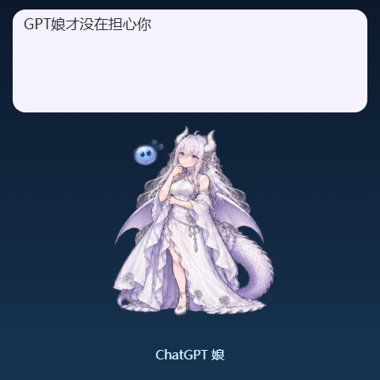

# 静态图片与投屏验证

日期：2026-10-23；Windows，Node 24.20.0。

| 检查 | 结果 |
| --- | --- |
| 源码与声明 | 构建、类型检查通过；共用 PetPack / ImagePosePlayer |
| 共享引擎 | 661 项，660 通过，1 项已有跳过 |
| 屏幕与安装回归 | 43 项，41 通过；2 项冷启动检查由 Windows CI 执行 |
| Python 输出链路 | 20 项通过，包括帧尺寸、旋转、输入和设备会话 |
| 实际 Chromium 合成 | 32 个姿势全部变成 480×480 PNG；经真实 /frame 与 /frame.png 接口回读，字节一致；角色像素匹配 |
| 实际 Electron | 图片 ready、画布可见、错误层关闭、鼠标穿透切换通过；renderer → IPC → bridge 实际收到 480×480 PNG |
| 设置与控制台 | 14 项设置 UI 测试通过；多实例选择、断开重连、旋转、双人互动与移动端布局通过 |
| 原素材 | 394 条上游媒体/字体记录逐字节核对通过 |
| 图片同步 | 两仓库的 4 张 PNG 完全相同，哈希记录在 art-source/generation.json |

本次验证的是软件取帧与输出适配，USB worker 明确关闭，没有进行物理屏幕 streaming 验收。此前的硬件记录不能替代本版硬件验收。

DSH 0.2.0-rc.2 已通过官方 CLI 实际安装独立版 2.0.1。已打开真实应用确认插件版本为 2.0.1、组件显示运行中，并通过宿主角色接口切换到 ChatGPT，检查实际桌面窗口中的透明 PNG 和动作切换；随后恢复原来的大肥鱼角色。没有发送模型消息或调用付费 API。

复现：先安装 dsh-pet 开发依赖并构建，再运行 scripts/test-screen-frames.mjs。可用 PET_TEST_BROWSER 指定现有 Chromium 浏览器。原生检查运行 scripts/test-native-screen.mjs，并设置 DSH_PET_ELECTRON_PATH；测试使用独立配置并关闭 USB，不调用模型。
